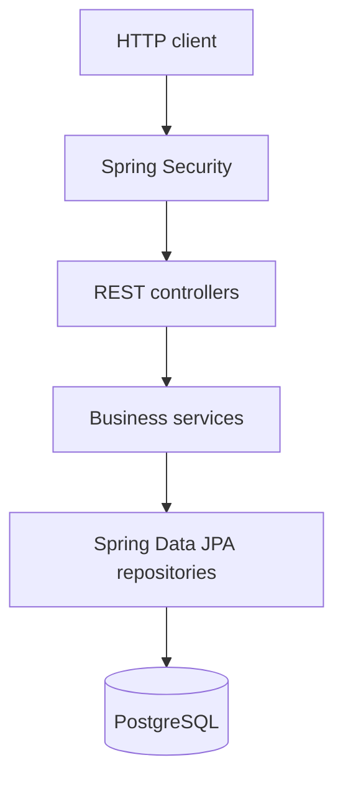

# 🏗️ System Architecture

## Overview

Funds Transfer Service is a single Spring Boot REST application backed by PostgreSQL. It is organized by business feature (`account` and `transfer`), with shared security, exception handling and health-check components.

`TransferService` coordinates transfers and delegates account operations to `AccountService`. Keeping both features within one application and database allows transfers to execute within a single transaction.

## Database Design

| Table | Responsibility |
| --- | --- |
| `accounts` | Account owner names and current balances |
| `transfers` | Sender, recipient, amount and transfer history |
| `transfer_idempotency` | Unique request keys, fingerprints, expiration and completed transfer references |

Monetary values use Java `BigDecimal` and PostgreSQL `NUMERIC(19,2)` to avoid binary floating-point rounding errors. Database constraints enforce nonnegative balances and valid transfers. Flyway manages versioned schema migrations.

## Key Engineering Decisions

### Transaction boundaries

A transfer reserves its idempotency key, locks the affected accounts, validates available funds, updates balances, persists the transfer and completes the reservation within one database transaction. If the transaction rolls back, these changes are reverted together.

Deposits also execute within a transaction and lock the target account before modifying its balance.

### Concurrency control

Account updates use PostgreSQL pessimistic write locks to prevent lost updates. Transfers acquire locks in ascending account-ID order to reduce deadlock risk, regardless of transfer direction.

Database-level locking coordinates requests across application instances sharing the same database. The trade-off is that competing operations must wait for locks to be released. Consistent lock ordering reduces, but does not eliminate, deadlock risk.

### Transfer idempotency

The application uses a unique database constraint and `INSERT ... ON CONFLICT DO NOTHING` to reserve idempotency keys atomically, avoiding check-then-insert race conditions.

Request identity is determined by a SHA-256 fingerprint of the sender ID, recipient ID and normalized amount.

| Key state | Behavior |
| --- | --- |
| New key | Reserve and execute the transfer |
| Unexpired key, identical payload | Return the original transfer without modifying balances |
| Unexpired key, different payload | Reject with `409 Conflict` |
| Expired key still stored | Reject with `409 Conflict` until cleanup |

Keys expire after 24 hours and are removed by a scheduled cleanup job. Transfer history is retained. After cleanup, a late retry may create a new transfer; the current design does not guarantee permanent duplicate prevention.

## Security

The API uses stateless HTTP Basic authentication with a single in-memory administrator. Credentials are supplied through environment variables and passwords are hashed using BCrypt for in-memory verification.

All requests except `/healthz` require authentication. HTTPS protects credentials in transit in the hosted environment. Individual user identities and account ownership are not yet implemented. CSRF protection is disabled for the current non-browser API and must be reassessed before introducing browser-based authentication.

## Runtime Architecture

The Spring Boot application runs as a Docker-based Render Web Service and connects to managed PostgreSQL on Neon. Local development and automated integration tests use separate database environments.

## Design Limitations

- Deposits do not yet have independent history or idempotency protection.
- Transfer retry protection is limited to the idempotency retention window.
- The shared administrator account does not provide user-level authorization.
- The current balance-and-transfer model is not a double-entry accounting ledger.
- List endpoints are not yet paginated; lock-timeout handling and distributed cleanup coordination remain limited.
- The public health endpoint checks HTTP availability, not database health.

The system handles simulated funds and is intended as a portfolio project, not a production banking system.
